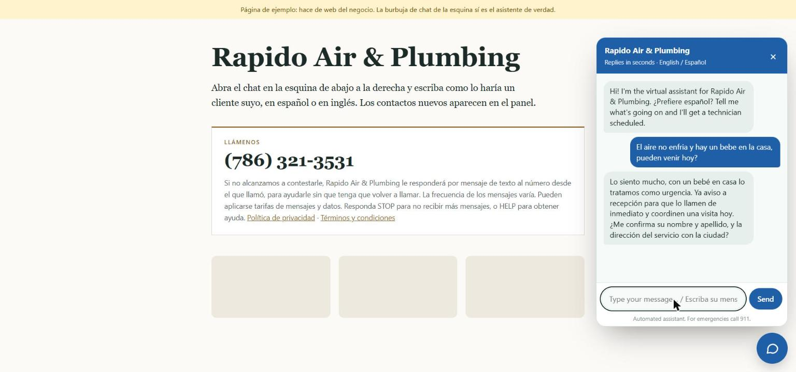
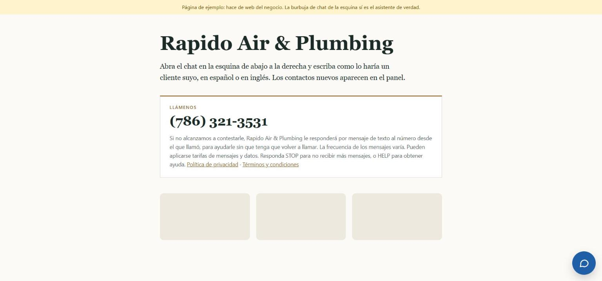

# AI Front Desk

A bilingual (English / Spanish) front desk for small local businesses. When a customer
calls and nobody picks up, the business texts them back within seconds, works out what
they need, and hands the staff a finished lead.

**Try it:** [missedtotext.com/demo/rapido-air](https://missedtotext.com/demo/rapido-air) —
open the chat and write as a customer would, in either language. Or call
**+1 786 321 3531**, let it ring, and hang up. The text-back is real.



The customer wrote in Spanish to a greeting in English. The assistant switched language,
treated a baby in the house as an emergency, flagged it for a human, and started
collecting the name and service address — from one sentence.

## The problem

A two-person A/C company in Miami misses most of its calls, because the people who would
answer the phone are the people on the roof. The caller does not leave a voicemail. They
call the next company in the search results.

A receptionist costs more than the jobs they would save. Voicemail does not work, because
nobody listens to voicemail any more.

## What it does

```
Customer calls  ──▶  nobody answers  ──▶  Twilio webhook
                                             │
                                             ▼
                              "Sorry we missed your call -
                               what's going on?"
                                             │
                      customer replies, in whatever language
                                             │
                                             ▼
                      Claude qualifies: what they need, how
                      urgent, preferred time, service address
                                             │
                        ┌────────────────────┴───────────────┐
                        ▼                                    ▼
              SMS alert to the owner                 lead in the dashboard
              (deliberately no personal              (with the full
               data in the text itself)               conversation)
```

The same assistant also runs as a chat bubble on the business's own site — one script
tag, isolated in a shadow root so it cannot collide with their CSS.



## What is interesting about it

### One codebase, any industry

Industries differ in ways the conversation has to respect: a dental clinic needs the
insurance carrier, a plumber needs the service address, a body shop needs the car. Each
one is a **vertical pack** in [`src/verticals.js`](src/verticals.js) holding its job
types, the extra fact to collect, and its own safety rules — a legal pack that must never
say whether someone has a case, a home-services pack that must never talk a customer
through a repair, a dental pack that must never diagnose and sends a bad infection to 911.

Adding an industry is a pack. Adding a business is one JSON file.

### Bilingual on two separate axes

Members of the public are answered in the language *they* wrote in, decided per person
and per message. Separately, each business file sets the language its *own staff* reads:
the dashboard, the SMS alerts, the lead summaries.

So a shop in Hialeah can have Spanish-speaking staff and still serve English-speaking
customers in English, from one install.

### Structured output rather than prompt-and-hope

Every turn returns a typed object — the reply to send, whether to escalate to a human,
and the lead fields — against a JSON schema built per vertical, so the job type can only
ever be one this industry actually offers. There is no free-text slot where a lead field
should be.

### Carrier compliance, which turned out to be most of the work

Sending application SMS to US phones means A2P 10DLC registration: a brand, a campaign,
and a reviewer who reads your pages. That shaped the code more than any feature did.

- `/privacy` and `/terms` exist because the campaign requires them, with the exact
  wording carriers look for.
- The demo page is **rendered on the server**, because the reviewer's crawler does not
  run JavaScript, and a page that paints itself in the browser looks empty to it.
- STOP and HELP are answered — HELP even after opt-out, because carriers require it.
- The SMS simulator is disabled in production: it has no login, and anyone who found the
  URL could spend the account's API credit.
- Twilio request signatures are verified on every webhook.

Brand and campaign are approved, and the number is live.

### Two database drivers behind one interface

Development runs on `node:sqlite` with no setup; production runs on MySQL. Both implement
the same small `{ all, run }` interface, chosen at startup from the environment — because
the production host wipes the application's filesystem on every deploy, so a file-backed
database would have quietly lost every lead. That was found by asking the assistant to
recall a caller after a redeploy and watching it answer like a stranger.

## Stack

Node 22+ · Express 5 · ESM · Claude (`claude-opus-5`, structured outputs) · Twilio Voice
and SMS · MySQL / `node:sqlite` · no front-end framework

## Running it locally

```bash
npm install
cp .env.example .env     # add your own keys
npm run dev
```

With `MOCK_SMS=true` no real texts are sent and `/simulator` fakes inbound messages, so
the whole flow can be exercised without Twilio.

[`MANUAL.md`](MANUAL.md) is the operator's guide, in Spanish: how to add a business, wire
up its number, and put the chat bubble on its site.

## Layout

```
src/
  agent.js        the model call, output schema, lead extraction
  verticals.js    industry packs: job types, qualifiers, safety rules
  conversation.js turn handling, opt-out and HELP, front-desk alerts
  db.js           driver selection; db-mysql.js / db-sqlite.js
  routes/         chat, dashboard, Twilio webhooks, dev tools
public/           widget, dashboard, demo page, privacy, terms
businesses/       one JSON file per business (_template.json documents every field)
```

## Not built yet

Voice answering — it texts back, it does not hold a conversation on the phone. Real
calendar booking: it records a preferred time and says the front desk will confirm, and
never claims anything is booked. Reminders. Subscription billing.

## Status

In production on its own domain, with a registered US phone number, an approved A2P
campaign, and live end-to-end conversations in both languages. Not yet serving paying
clients — it is being sold to local businesses in Hialeah, Florida.

---

Built by Ariel Merino Chong, Miami.
